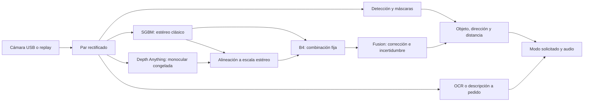

# VisionX — qué queremos construir y qué falta hacer

Actualizado: **2 de noviembre de 2026**. Material interno para Tomás, Bauty y sus agentes.
Entrega académica: **10 de diciembre de 2026**, confirmada por Tomás.

Este archivo contiene el plan y el estado de las tareas. [TECNICO](TECNICO.md) explica cómo
funciona cada parte. [BITACORA](BITACORA.md) cuenta lo que pasó realmente, con evidencia,
problemas y decisiones. No hay que buscar fichas ni índices A/B en otras carpetas.

## Cómo leerlo

1. [Objetivo y alcance](#objetivo-y-alcance): para qué existe el proyecto.
2. [Estado real](#estado-real): qué está disponible y qué todavía es futuro.
3. [Recorrido y decisiones](#recorrido-y-decisiones): cómo se conecta todo.
4. [Etapas](#etapas): qué debe funcionar primero y qué se agrega después.
5. [Tareas](#tareas): una tabla de estados y veinte bloques con entregables.
6. [Organización del trabajo](#organizacion-del-trabajo): cómo paralelizar sin pisarse.
7. [Correspondencia anterior](#correspondencia-anterior): dónde quedó cada ID viejo.

## Objetivo y alcance

VisionX busca ayudar a una persona con baja visión a **encontrar un objeto, orientarse hacia
él, consultar su distancia, leer texto y entender qué tiene enfrente mediante audio**.
El dashboard, una pantalla de diagnóstico, es para nosotros y para explicar la demo;
el usuario no necesita mirarlo.

La investigación central es **SpatialDepth-Fusion**, una CNN propia: una red que aprende
patrones locales en imágenes. Combina la profundidad clásica de dos cámaras con la
estimación de una red monocular preentrenada, Depth Anything V2 Small. Además estima
incertidumbre para estudiar cuándo conviene responder y cuándo abstenerse.

La pregunta es si podemos mejorar una combinación fija de ambas fuentes con una red
compacta y obtener distancias útiles en una cámara USB económica. No sabemos todavía
si ganará: medir y explicar un resultado negativo también forma parte del trabajo científico.

**Alcance completo comprometido:** cuatro modos USB; evaluación contra cuatro modelos
preentrenados; Fusion; incertidumbre; Lite mediante destilación; Fusion-FFS; portátil con
Raspberry/batería y alerta de cercanía. La entrega de diciembre prioriza USB, Fusion y
evaluación. Lo restante continúa después si no está aceptado; no se elimina por ser dos personas.
SLAM y memoria persistente de objetos siguen fuera del alcance acordado: no construiremos
un mapa acumulado ni diremos dónde quedó algo que ya no está visible.

## Estado real

Foto de la base publicada al iniciar esta revisión: `526facc`, PR #11 integrado.
La reorganización actual es **solo documental**; no instala funcionalidades futuras.

| Disponible | Evidencia y límite |
|---|---|
| Entorno Python/uv, CI y protección de main | Registros Windows/Mac del 28/10; no equivalen a una demo |
| Contratos y geometría compartida, schema 3 | PR #10 `d8a38bd`: validación, offsets, recortes, arrays estables |
| Configuración distribuida y diagnóstico | PR #11 `526facc`: wheel, overrides explícitos y pruebas de instalación |
| Tests del núcleo | Resultado histórico conjunto: 197 aprobados en Windows; no se reejecutaron para esta planificación |
| Cámara ELP | Tomás confirmó que el módulo está en nuestras manos; aún falta evidencia de captura/calibración aceptada |
| Mac de demo | Bauty registró M2 Max/32 GB y MPS disponible; falta medir el pipeline real |
| Almacén Drive | Ubicación definida; falta confirmar recepción del archivo/hash de prueba desde Mac |

**Todavía no aceptados en main:** replay y fakes de producción, aplicación, captura/calibración
real, detector, voz, OCR, descripción, B0–B4, CNN entrenada, comparadores y portátil.
Los ejemplos de fakes dentro de tests no constituyen esos módulos terminados.
El intento local adelantado por Codex no se incorpora: fue detenido por Tomás al aclarar
que el pedido era planificación. No cuenta como avance aceptado.

Faltan confirmar con la cátedra la aprobación administrativa del equipo/tema y el formato
definitivo. Se conserva como propuesta informe total de hasta ocho páginas y póster vertical
A0/A1; no se presenta esa aprobación como obtenida.

## Recorrido y decisiones

Una imagen estéreo contiene dos vistas simultáneas. La captura las separa y la calibración
las lleva a una geometría conocida. Desde ahí se ejecutan profundidad y detección:

Una máscara señala los píxeles de un objeto. Sirve para medir su superficie y evitar tomar
el fondo dentro de una caja. La política por objeto decide entre metros, dirección,
reencuadre o abstención. El VLM, modelo que interpreta imagen y lenguaje, puede enriquecer
una descripción; las distancias siempre salen de las mediciones estructuradas.

| Tema | Decisión de trabajo y motivo | Alternativa y qué la decidiría |
|---|---|---|
| Aplicación | Monolito modular: una aplicación con partes separadas; fácil de ejecutar y seguir | Más procesos solo si una medición demuestra necesidad; no microservicios por rutina |
| Monocular | Depth Anything V2 Small relativa, preentrenada y congelada | Variante métrica como experimento aparte; no asumir que reemplaza calibración |
| Fusión | U-Net residual sobre B4; conservar referencia F0 de diez canales | F1 agrega máscara monocular; F2/F3 exploran calidad del ajuste/distancia a anclas |
| Ejecución | Interactivo y comparación científica separados | El interactivo prioriza actualidad; la comparación procesa los mismos pares sin descartarlos |
| Resolución | Medir 640×360, 960×540 y 1280×720 por ojo | Elegir por precisión/cobertura/latencia, no por el preset del YAML |
| Detección | Evaluar YOLO26n-seg y referencia YOLO11n-seg | Modelo mayor si ayuda a objetos pequeños; YOLOE para categorías nuevas con máscaras |
| Voz | Botón + órdenes explícitas; STT local y TTS local | MLX Whisper en Mac, faster-whisper CPU/CUDA según equipo; comparar frases reales |
| OCR | Evaluar RapidOCR/ONNX con soporte de español | Otra implementación si CER, números o latencia no alcanzan |
| Descripción | Plantilla local más VLM a pedido | Proveedor/modelo remoto no elegido; evaluar respuestas, timeout, coste y fallback |
| Portátil | Raspberry captura, transmite y reproduce audio; computadora procesa | Migrar más cómputo al dispositivo solo con evidencia de energía y velocidad |

Estas opciones son candidatos de planificación. No se afirma que ya estén instaladas,
comparadas ni que alguna versión garantice mejor rendimiento.

## Etapas

Una etapa indica una capacidad demostrable. Los números no obligan a esperar todo lo anterior
para empezar: voz puede avanzar con ejemplos; los comparadores con pares públicos; la app con fakes.

| Etapa | Resultado que permite avanzar |
|---|---|
| Base reproducible | Leer el mismo par en Windows/Mac y generar salidas simuladas consistentes, con IDs y errores claros |
| USB clásico | Cámara calibrada, SGBM y metros con referencia física; audio/cancelación básicos |
| Cuatro modos base | Buscar/guiar, distancia, leer y describir por USB; pueden empezar con proveedor clásico |
| Investigación | Datos y protocolo fijados; B4, Fusion entrenada, ablaciones y cuatro comparadores |
| Entrega académica | Cuatro modos con Fusion integrada, evaluación trazable, informe, póster y respaldo offline |
| VisionX completo | También Lite, Fusion-FFS, portátil y alerta con sus pruebas; no se tilda al cerrar diciembre |

### Base y pulido de los cuatro modos

| Modo | Primera versión funcional | Luego, sin cambiar el objetivo |
|---|---|---|
| Buscar/guiar | Clase, presencia, bip, dirección y cancelar | Varios iguales, elección de instancia, tracking, pérdida/reaparición y atributos |
| Distancia | Congelar par y responder metros o abstenerse | Política por objeto, rangos, intervalos y redondeo calibrados |
| Leer | Elegir frame y leer bloques cancelables | Nitidez, encuadre, números, CER y recuperación de errores |
| Describir | Plantilla local con hechos medidos | VLM a pedido, respuesta breve, control de afirmaciones y fallback sin red |

No exigir profundidad fiable para avisar que un objeto fue detectado. No confundir una
demostración simulada con una versión funcional aceptada sobre hardware.

### Calendario objetivo

| Fecha de 2026 | Salida buscada; todavía no es evidencia |
|---|---|
| 2–5 noviembre | Cerrar planificación; base/replay, captura/calibración inicial y preparación de datos/comparadores |
| 6–12 noviembre | USB clásico, cuatro modos base y protocolo fijado |
| 13–19 noviembre | Piloto/overfit, entrenamiento Fusion y ejecución de comparadores |
| 20–26 noviembre | Integración, ablaciones, incertidumbre y fallos |
| 27 noviembre–3 diciembre | Test reservado, reproducción cruzada, tablas e informe |
| 4–9 diciembre | Correcciones verificadas, tres ensayos y respaldo |
| 10 diciembre | Entrega académica |
| Continuidad | Capacidades pendientes del alcance completo, con nuevas fechas basadas en evidencia |

Si una fecha falla, registrar causa, impacto y nuevo paso en BITACORA. Una demora no convierte
una capacidad en descartada ni autoriza afirmar que se probó algo que no se hizo.

## Tareas

Esta es la **única tabla de estado**. Los bloques siguientes describen el alcance; no duplican
estados. A=Bauty y B=Tomás son responsables de integración, no los únicos posibles ejecutores.
Para evitar esperas falsas, cada bloque distingue inicio con ejemplos de aceptación real.

Estados: **pendiente**, **en curso**, **parcial**, **por integrar**, **bloqueada**, **hecha**.
Una tarea bloqueada debe tener causa y próximo paso en BITACORA. Hecha requiere evidencia;
si hay código integrado pero falta recepción, escribir ambos hechos sin ocultar disponibilidad.

| ID | Capacidad | Integra | Estado al 02/11 | Reserva activa |
|---|---|---|---|---|
| T01 | Base reproducible, contratos y artefactos | A+B | Parcial: base publicada; recepción/almacén y utilidades pendientes | Ninguna |
| T02 | Captura USB, grabación y replay | B | Pendiente; modos ELP y 10/30 min medidos en Mac (BITACORA 2026-11-12, `scripts/calibracion/modos.py`), falta Windows | Ninguna |
| T03 | Calibración y validación física | B con evaluación A | En curso: calibración s6 (`configs/calib/elp-2026-11-11.yaml`); cinta 1–3 m hecha: +3 a +5 % por corrimiento de disparidad ~0,5 px, corregible a < 0,5 %; decidir si se acepta esa corrección (BITACORA 2026-11-12) | Bauty+Tomás, rama `a/T03-calibrador`, `src/visionx/calibration/`, `scripts/calibracion/`, ELP en Mac de Bauty |
| T04 | Datos, GT, particiones y protocolo | A con capturas B | Pendiente | Ninguna |
| T05 | Estéreo, monocular, alineación y B0–B4 | A | Pendiente | Ninguna |
| T06 | Detección, máscaras y seguimiento | B | Pendiente | Ninguna |
| T07 | Ejecución interactiva/científica y dashboard | B | Pendiente | Ninguna |
| T08 | Voz, audio y cancelación | B | Pendiente | Ninguna |
| T09 | Buscar/guiar y medir distancia | B con espacial A | Pendiente | Ninguna |
| T10 | Leer texto | B | Pendiente | Ninguna |
| T11 | Describir escenas | B | Pendiente | Ninguna |
| T12 | Canales, CNN, entrenamiento e integración Fusion | A con carga B | Pendiente | Ninguna |
| T13 | Incertidumbre y política por objeto | A con uso B | Pendiente | Ninguna |
| T14 | Cuatro comparadores preentrenados | A | Pendiente | Ninguna |
| T15 | Evaluación final y reportes | A+B | Pendiente | Ninguna |
| T16 | Informe, póster, reproducción y entrega | A+B | Pendiente | Ninguna |
| T17 | Pseudoetiquetas y Lite | A | Pendiente | Ninguna |
| T18 | Fusion-FFS | A | Pendiente | Ninguna |
| T19 | Raspberry, transporte, audio y energía | B | Pendiente | Ninguna |
| T20 | Alerta de cercanía | B con política A | Pendiente | Ninguna |

Los worktrees antiguos B01/B03 no constituyen reservas actuales confirmadas. Consultar a
su ejecutor antes de continuar o retirar sus cambios. El intento C10 de código está detenido.
La reserva documental de esta reorganización se registra en BITACORA; no inicia las veinte tareas.

### T01 — Base reproducible, contratos y artefactos

- **Entrada:** código publicado, entornos Windows/Mac y acceso al Drive compartido.
- **Hacer:** recibir schema 3, completar fakes públicos de profundidad/detector/audio y ejemplos
  deterministas. Confirmar hashes en ambas PCs y mantener config/wheel reproducibles.
- **Pendiente adicional:** adaptar las utilidades heredadas de registro para no recrear el esquema
  viejo. Hoy se consulta/escribe directamente en estos documentos; esta revisión no cambia código.
- **Salida/aceptación:** instalación y veinte pares compatibles en ambas PCs, errores adversos
  rechazados, cero cruces de geometría, artefacto descargable con el mismo hash. M0/M12 en TECNICO.

### T02 — Captura USB, grabación y replay

- **Inicio:** interfaces de T01; el replay empieza sin cámara con pares artificiales.
- **Hacer:** separar SBS sin invertir ojos, conservar sesión/tiempo, registrar pares atómicos,
  manejar fin de grabación, cierre y reconexión. Enumerar modos reales ELP en Windows y Mac.
- **Salida/aceptación:** grabación que A puede procesar sin ELP; mismos IDs/contenido en replay;
  diez minutos por modo finalista con FPS efectivo, caídas y memoria. M0/M2; USB requiere ELP.

### T03 — Calibración y validación física

- **Entrada:** pares reales de T02 y tablero ChArUco con dimensiones físicas medidas.
- **Hacer:** capturas variadas, calibración y rectificación; validación separada por A, incluyendo
  bordes, resize, estabilidad entre sesiones y escala con distancia externa.
- **Salida/aceptación:** matrices/unidades/modo/ID y reporte M3; ninguna corrección manual de metros.
  Imágenes de validación y test no se reutilizan como si fueran evidencia independiente del ajuste.

### T04 — Datos, GT y protocolo

- **Inicio:** datos públicos sin esperar USB; banco ELP cuando T03 fija geometría.
- **Hacer:** InStereo2K para entrenamiento/validación, Middlebury/ETH3D para evaluación y escenas
  ELP separadas por sesión. Auditar diez muestras por adaptador; reservar test físico temprano.
- **Salida/aceptación:** archivos/splits/hash/licencias, reglas de GT y métricas, presupuesto y
  checkpoint fijados antes de entrenar/evaluar. Cero fuga de escenas. M4; tablero no da GT del fondo.

### T05 — Profundidad clásica, monocular y B0–B4

- **Inicio:** contratos y pares sintéticos; evaluar con T04 y calibración real T03.
- **Hacer:** SGBM, L/R, WLS, DA V2 Small congelada, alineación robusta y B4. Medir cantidad,
  distribución y residuos de anclas. Fallback claro si el monocular no tiene escala fiable.
- **Salida/aceptación:** misma API para B0–B4, mapas/validez/diagnóstico y tabla error-cobertura-tiempo.
  Medir el conjunto SGBM+DA+alineación en Mac antes de fijar resolución. M4/M9.

### T06 — Detección, segmentación y seguimiento

- **Inicio:** replay/fake; detector real cuando estén pesos y backend preparados.
- **Hacer:** evaluar YOLO26n-seg contra YOLO11n-seg, tamaño mayor si aporta y YOLOE para
  categorías fuera del vocabulario fijo. ByteTrack primero; huella visual si la pérdida lo exige.
- **Salida/aceptación:** máscaras en geometría conocida, catálogo de clases realmente soportadas,
  al menos cien frames de tres clips anotados y diez pérdidas/reapariciones. Fallo no es ausencia.

### T07 — Ejecución y dashboard

- **Inicio:** T01/T02 con fakes; recepción física posterior con T03/T05/T06.
- **Hacer:** captura independiente, colas acotadas, unión por frame, cancelación y trazas. Dos
  recorridos: interactivo actual y comparación del mismo par. Dashboard con edad/estado/unidades;
  nube de puntos por frame, sin mapa acumulado.
- **Salida/aceptación:** cero mezcla de frames; diez minutos bajo sobrecarga sin cola creciente.
  Mediciones M1/M9; mapas del panel reutilizan resultados, no recalculan redes para dibujar.

### T08 — Voz, audio y cancelación

- **Inicio:** teclado/JSON y audio grabado; micrófono y STT se incorporan por adaptadores.
- **Hacer:** botón/VAD, Whisper local por backend, reglas en español y Piper/frases preparadas.
  Probar AirPods, mic alternativo, simultaneidad, reconexión y cancelar durante TTS.
- **Salida/aceptación:** Command/AudioEvent públicos, 50–100 frases medidas, cancelación prioritaria
  y matriz dispositivo/SO con latencia audible. M1/M10; alternativa si Bluetooth falla.

### T09 — Buscar, elegir, guiar y distancia

- **Inicio:** objeto/profundidad simulados; no esperar entrenamiento Fusion.
- **Hacer:** ubicación espacial A, selección entre iguales, pérdida, dirección, bip y distancia
  puntual sobre par congelado. Primera política conservadora; calibración de incertidumbre en T13.
- **Salida/aceptación:** ningún metro sin profundidad válida ni guía vieja; M1/M7/M8.
  A entrega SpatialObject; B consume esa salida sin duplicar la política de medida.

### T10 — Leer texto

- **Inicio:** frame y comando teclado; voz no bloquea desarrollar OCR.
- **Hacer:** OCR especializado, escoger frame nítido, ordenar bloques, guiar encuadre y leer
  cancelablemente. Evaluar español, números y etiquetas en las condiciones de cámara reales.
- **Salida/aceptación:** treinta textos con transcripción de referencia a 0,5/1 m, CER y tiempo
  a primera palabra; cámara sigue capturando y cancelar corta el pedido. M10.

### T11 — Describir escenas

- **Inicio:** plantilla local sobre objetos ficticios; sumar mediciones reales T09 y VLM aparte.
- **Hacer:** contexto breve solicitado por usuario, distancias compuestas desde datos; timeout,
  desconexión y cancelación. Envío remoto explícito, nunca continuo/silencioso.
- **Salida/aceptación:** treinta escenas anotadas, afirmaciones sin respaldo contabilizadas,
  cero distancias generadas como medición y plantilla sin internet. M10.

### T12 — Fusion: entradas, entrenamiento y uso

- **Inicio:** interfaces/ejemplos; entrenamiento real requiere T04/T05 y presupuesto aprobado.
- **Hacer:** un preprocesamiento público y caché invalidable; F0/F1, U-Net residual y cabeza b.
  Probar overfit, piloto, semillas, reanudación y selección en validación; preparar paquete e inferencia.
- **Salida/aceptación:** M5, canales/unidades auditados, checkpoint/hash/config/model card y
  paridad offline/aplicación. B cambia B4 por Fusion por configuración, sin copiar notebooks.
  Ablaciones y F2/F3 se eligen por validación; no se declara que once canales ganan por definición.

### T13 — Incertidumbre y política por objeto

- **Inicio:** métricas con errores conocidos; calibración real requiere T12 y desarrollo ELP.
- **Hacer:** NLL, AUSE, riesgo-cobertura e intervalos; comparar L/R/fotométrico. Validar objeto
  aparte, con cobertura, dispersión, escala y edad; fijar rango/abstención/redondeo.
- **Salida/aceptación:** curvas M6/M7, thresholds congelados antes del test. No trasladar b
  de píxeles a una supuesta probabilidad por objeto; informar si la hipótesis falla.

### T14 — Comparadores preentrenados

- **Inicio:** una fixture pública; preparar entornos sin esperar a que Fusion termine.
- **Checklist:** MonSter; DEFOM-Stereo; FoundationStereo; Fast-FoundationStereo.
- **Hacer:** registrar origen/commit/pesos/licencia/backend, resolver incompatibilidades con una
  ruta viable y evaluar mismos frames/GT. Entornos externos separados del núcleo si lo requieren.
- **Salida/aceptación:** cuatro reproducciones con error/cobertura/tiempo y límites M4/M9.
  Un fallo se documenta y se trabaja; ejecutar solo uno no completa este bloque.

### T15 — Evaluación final y resultados

- **Entrada:** candidato/protocolo congelados y test reservado de T04; cuatro modos integrados.
- **Hacer:** B0–B4/Fusion/ablaciones/comparadores, banco físico, uso/latencia y regresiones de
  cámara/audio/red/pesos ausentes. ROI manual ayuda a separar error detector de error depth.
- **Salida/aceptación:** M4/M6–M10; CSV por escena, cobertura/fallos y diferencias pareadas;
  figuras/tablas regenerables. No tocar thresholds con test ni seleccionar solo escenas ganadoras.

### T16 — Entrega académica y reproducción

- **Inicio:** confirmar formato/equipo con cátedra temprano; escribir desde BITACORA al avanzar.
- **Hacer:** método/resultados/discusión, informe/póster, propuesta actualizada, pesos/datos
  referenciados, video y respaldo offline. Cada persona reproduce el trabajo de la otra.
- **Salida/aceptación:** M12, cifras trazables y tres ensayos sin tocar código; tag/release solo
  cuando se solicite. Separar pendientes de continuidad de las funciones entregadas.

### T17 — Pseudoetiquetas y Lite

- **Entrada:** teacher Fusion evaluado y sesiones ELP de entrenamiento, nunca el test reservado.
- **Hacer:** generar etiquetas del teacher, auditar filtrado/sesgo y diversidad; entrenar Lite
  sin DA en inferencia. Comparar con la misma arquitectura sin destilar y calibrar su incertidumbre.
- **Salida/aceptación:** manifiestos, aceptación por escena y M11 del pipeline completo a misma
  cobertura. Cinco mil frames similares no son cinco mil escenas independientes.

### T18 — Fusion-FFS

- **Entrada:** FFS reproducido y presupuesto; no bloquea que Fusion-SGBM esté operativa.
- **Hacer:** adaptar entradas/confianza a FFS y entrenar/evaluar la variante con protocolo propio.
  Cambiar proveedor no es intercambiar un mapa conservando canales con significado incorrecto.
- **Salida/aceptación:** comparación contra FFS solo, mismo soporte y costes completos M4–M6/M9;
  paquete con versión. No sustituir el proveedor de demo sin recepción.

### T19 — Portátil, transporte y energía

- **Inicio:** protocolo con replay puede diseñarse temprano; hardware se conecta tras USB funcional.
- **Hacer:** Pi→PC pares atómicos, micrófono→PC y audio→Pi/auriculares; control/cancelación local,
  colas y reconexión. Medir MJPEG disponible, red, perfiles Bluetooth, consumo/calor y montaje.
- **Salida/aceptación:** M2/M11, USB vs Wi-Fi, tres corridas de diez minutos y wearable treinta
  minutos; autonomía real. No depende de Lite si el procesamiento continúa en computadora.

### T20 — Alerta de cercanía

- **Inicio:** política con replay/USB; no esperar a Pi para investigar la alerta.
- **Hacer:** zona central, exclusión del piso, persistencia, profundidad fresca, prioridad y pausa
  entre avisos. A/B eligen proveedor por precisión/cobertura/latencia, no por nombre del modelo.
- **Salida/aceptación:** diez recorridos controlados, obstáculos avisados, falsas alarmas y distancia/
  latencia de aviso. Suspender con datos vencidos; no presentarlo como navegación validada.

## Organizacion del trabajo

Un agente empieza por el bloque Txx y la sección técnica correspondiente. Registra qué va a
editar y qué recursos usa. Al terminar un paso, escribe en BITACORA: resultado, evidencia,
limitación y próximo paso. Solo se actualiza la tabla de estado cuando el hecho lo justifica.
Durante esta revisión documental no se comienza ninguna implementación.

Paralelismo útil: T02/T03 en hardware; T04/T05/T14 con datos públicos; T06–T11 con replay;
T12 sobre contratos y ejemplos. El entrenamiento largo espera datos/preprocesamiento correctos.
No duplicar tres veces una misma etapa para que cada agente tenga su propia infraestructura.

Entregar al otro significa: versión de código, artefacto/hash, comando real y salida esperada.
El consumidor verifica compatibilidad y registra recepción; no aprueba el contenido de cada PR.
Las antiguas I00–I08 quedan como referencias históricas de las siguientes aceptaciones, sin
archivo ni estados adicionales:

| Referencia anterior | Dónde se conserva su aceptación |
|---|---|
| I00 | T01 + replay T02: base recibida por ambas personas |
| I01 | T06–T09: primera demo objeto/audio |
| I02 | T02/T03/T05: USB, calibración y metros |
| I03 | T04/T05/T07: B4 y protocolo para entrenar |
| I04 | T12: paquete Fusion recibido en la aplicación |
| I05 | T08–T11 y política T13: cuatro modos USB |
| I06 | T14/T15: resultados científicos reproducibles |
| I07 | T17–T20: continuidad completa |
| I08 | T16: entrega y reproducción de ambos |

## Correspondencia anterior

Esta tabla evita perder trabajo ya mencionado en commits/PR. Se retiran las fichas del árbol
actual; los originales siguen en [la versión anterior de Git](https://github.com/BautyGarcia/tpf_visionx/tree/526facc82abf803c94271a25a784de1377484617/docs).
Un ID puede aparecer en dos bloques cuando antes mezclaba dos responsabilidades.

| Bloque | IDs previos absorbidos |
|---|---|
| T01 | C01–C05; A04, A04.1–A04.6, A05; B04, B27.1 |
| T02 | B01, B02, B08 |
| T03 | A07, B09, B10 |
| T04 | A01, A02, A09; B12.1, B20; C07 |
| T05 | A03, A08, A10, A11 |
| T06 | B06, B14 |
| T07 | B05, B07, B11, B12, B12.2; piloto de cómputo A13 |
| T08 | B03, B15; audio de B05 |
| T09 | A06, A19 inicial, B16 |
| T10 | B17 |
| T11 | B18 |
| T12 | A12–A15, A17, A18; B13 |
| T13 | A16, A19 calibrado |
| T14 | A24, A24.1–A24.4 |
| T15 | A20–A22; B19, B21; recepción del banco B20 |
| T16 | C06, C08; A23, A29; B26, B27 |
| T17 | A26, A27 |
| T18 | A25 |
| T19 | B22–B25 |
| T20 | A28, B28 |

C09 fue la reorganización anterior, publicada en PR #9 `3034f40`; queda como antecedente
en BITACORA, no como otra tarea pendiente. La implementación local llamada C10 fue detenida
y no se migra como capacidad hecha. Las recomendaciones nuevas se incluyen en los bloques
correspondientes; no generan otras sesenta tareas ni reducen el alcance.
